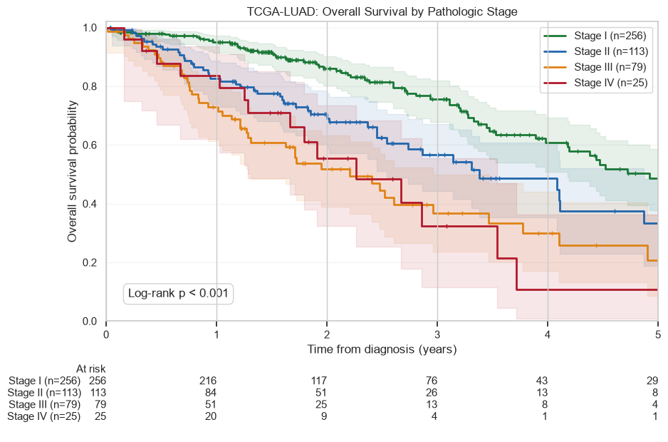
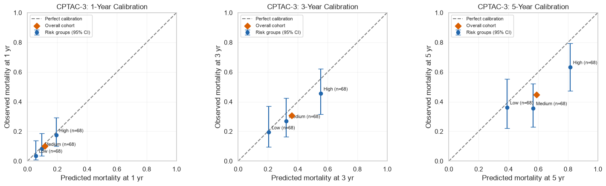

# Survival Analysis of Patients with Lung Adenocarcinoma Using Clinical Data and Driver Gene Mutation

> **Note on Full Methodology:** The complete end-to-end analytical pipeline, step-by-step methodology, reproducible code, and visualizations are documented in the [Primary Analysis Notebook](notebook/tcga-luad-survival.ipynb).

## 1. Clinical Background & Objective

Estimating survival helps guide patient counseling and treatment planning in lung adenocarcinoma. Cancer stage helps estimate survival, but it does not fully explain differences in survival between individual patients. This project investigates how clinical characteristics and somatic mutations contribute to overall survival estimation beyond stage-based assessment.

The informatics objective is to develop a multivariable Cox proportional hazards model using age, sex, pathologic stage, and **KEAP1, STK11, SMARCA4, and TP53** mutation indicators in TCGA-LUAD, followed by external evaluation in CPTAC-3. Overall survival is measured in days: death defines the event, and living patients are censored at their latest recorded follow-up.

## 2. Cohort & Clinical Data Pipeline

Clinical data and somatic mutation profiles were obtained from **TCGA-LUAD (The Cancer Genome Atlas–Lung Adenocarcinoma)** through the [NCI Genomic Data Commons portal](https://portal.gdc.cancer.gov/projects/TCGA-LUAD).

The final dataset included **473 patients** for model development, with **172 deaths (36.4%)**. The analytical variables comprised age, sex, pathologic stage (I–IV), overall survival duration, death or censoring status, and mutation status for **KEAP1, STK11, SMARCA4, and TP53**.

*Detailed workflow: [Exploratory Data Analysis](notebook/tcga-luad-survival.ipynb#Exploratory-Data-Analysis).*

## 3. Methodology & Benchmark Performance

Kaplan–Meier analysis compared overall survival across pathologic stages I–IV. Survival differed significantly between stage groups (omnibus log-rank p < 0.001), with Stage I showing the highest survival probability over the displayed five-year period.



*Figure 1. Overall survival by pathologic stage in TCGA-LUAD. Shaded bands represent 95% confidence intervals, tick marks indicate censoring, and the table below shows the number of patients at risk.*

A multivariable Cox proportional hazards model estimated associations between overall survival and age, sex, pathologic stage, and the four mutation indicators. The model achieved an apparent training C-index of **0.6936** (95% CI: 0.6498–0.7354). After adjustment, **STK11** mutation was associated with higher mortality hazard (HR **1.651**, 95% CI: **1.083–2.517**, p = **0.020**). Stage II, III, and IV also showed higher hazards than Stage I (HR 1.97, 3.15, and 3.49, respectively; all p < 0.005).

*Detailed analysis: [Kaplan-Meier Survival Analysis by Pathologic Stage](notebook/tcga-luad-survival.ipynb#Kaplan-Meier-Survival-Analysis-by-Pathologic-Stage) and [Multivariable Cox Proportional Hazards Model](notebook/tcga-luad-survival.ipynb#Multivariable-Cox-Proportional-Hazards-Model).*

## 4. External Validation and Calibration on CPTAC-3

Clinical data and somatic mutation profiles were obtained from the lung adenocarcinoma cohort within **CPTAC-3 (Clinical Proteomic Tumor Analysis Consortium, Phase 3)** through the [NCI Genomic Data Commons (GDC) Data Portal](https://portal.gdc.cancer.gov/projects/CPTAC-3). The external validation cohort included **204 patients**, with **55 deaths (27.0%)**. Discrimination is evaluated using the concordance index.

| Evaluation of the Cox model | Patients | Deaths | C-index | Bootstrap 95% CI |
| :--- | ---: | ---: | ---: | :--- |
| TCGA-LUAD: training | 473 | 172 | **0.6936** | 0.6498–0.7354 |
| CPTAC-3: external validation | 204 | 55 | **0.6474** | 0.5712–0.7160 |

Calibration assessed how closely predicted mortality matched observed mortality at 1, 3, and 5 years. Patients were divided into three risk groups of 68 patients each, and mean predictions were compared with Kaplan–Meier estimates. At 5 years, observed mortality estimates were lower than predicted in all three groups, indicating overprediction at this horizon.



*Figure 2. CPTAC-3 calibration at 1, 3, and 5 years. Error bars show 95% confidence intervals; the dashed line indicates perfect agreement.*

*Detailed evaluation: [External Validation](notebook/tcga-luad-survival.ipynb#External-Validation) and [External Calibration](notebook/tcga-luad-survival.ipynb#External-Calibration).*

## 5. Gene Mutation Prognostic Impact

**STK11** mutation was associated with a 65.1% higher mortality hazard after adjustment (HR 1.651, p = 0.020). **SMARCA4** had an elevated hazard ratio (HR 1.526, p = 0.085), but the association was not statistically significant. **TP53** (HR 1.254, p = 0.170) and **KEAP1** (HR 1.167, p = 0.424) also showed no statistically significant associations with overall survival. Among the four genes, only STK11 reached the statistical significance threshold of p < 0.05.

| Mutation | Hazard ratio | 95% CI | p-value |
| :--- | ---: | :--- | ---: |
| STK11 | **1.651** | **1.083–2.517** | **0.020** |
| SMARCA4 | 1.526 | 0.943–2.469 | 0.085 |
| TP53 | 1.254 | 0.908–1.732 | 0.170 |
| KEAP1 | 1.167 | 0.800–1.703 | 0.424 |

*Detailed analysis: [Summary of Gene Mutation Prognostic Impact](notebook/tcga-luad-survival.ipynb#Summary-of-Gene-Mutation-Prognostic-Impact) and [Proportional Hazards Assumption Diagnostic](notebook/tcga-luad-survival.ipynb#Proportional-Hazards-Assumption-Diagnostic).*

## 6. End-to-End Workflow & Reproducibility

The notebook's primary milestones, in execution order, are:

- [Import Packages and Load Dataset](notebook/tcga-luad-survival.ipynb#Import-Packages-and-Load-Dataset)
- [Exploratory Data Analysis](notebook/tcga-luad-survival.ipynb#Exploratory-Data-Analysis)
- [Survival Analysis, Results and Evaluation](notebook/tcga-luad-survival.ipynb#Survival-Analysis,-Results-and-Evaluation)
- [External Validation and Calibration on CPTAC-3](notebook/tcga-luad-survival.ipynb#External-Validation-and-Calibration-on-CPTAC-3)

Use Python 3 with the imported scientific packages and retain the notebook's documented `data/` directory structure. From the repository root:

```bash
python3 -m pip install numpy pandas scipy matplotlib seaborn lifelines ipython notebook
python3 -m notebook notebook/tcga-luad-survival.ipynb
```

Run notebook cells sequentially from top to bottom.

---

The full step-by-step analytical workflow, code, saved results, and visualizations are documented in the companion [Primary Analysis Notebook](notebook/tcga-luad-survival.ipynb).
